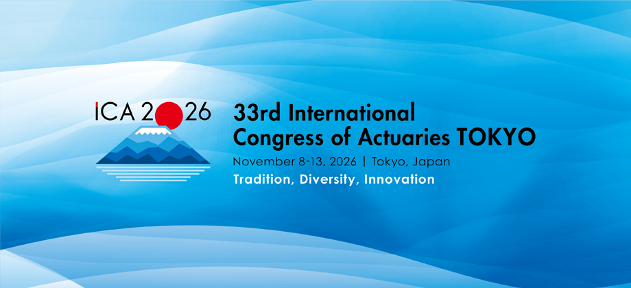
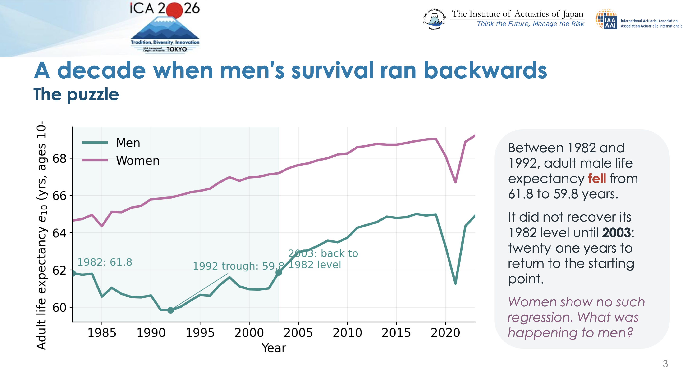
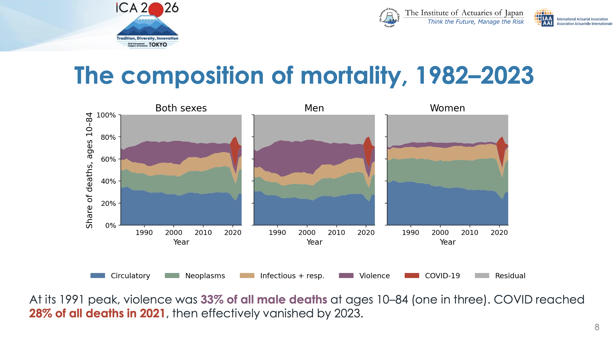
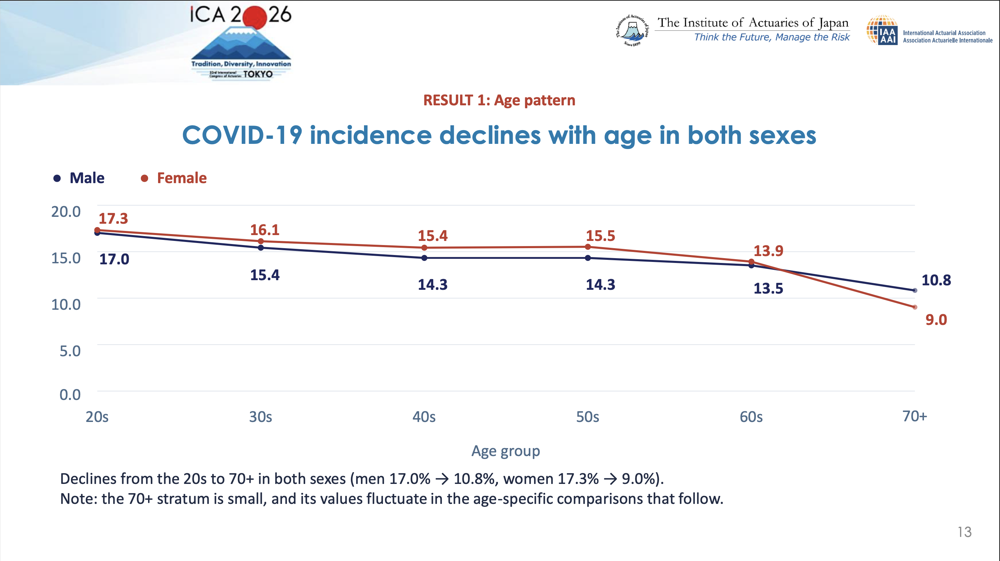
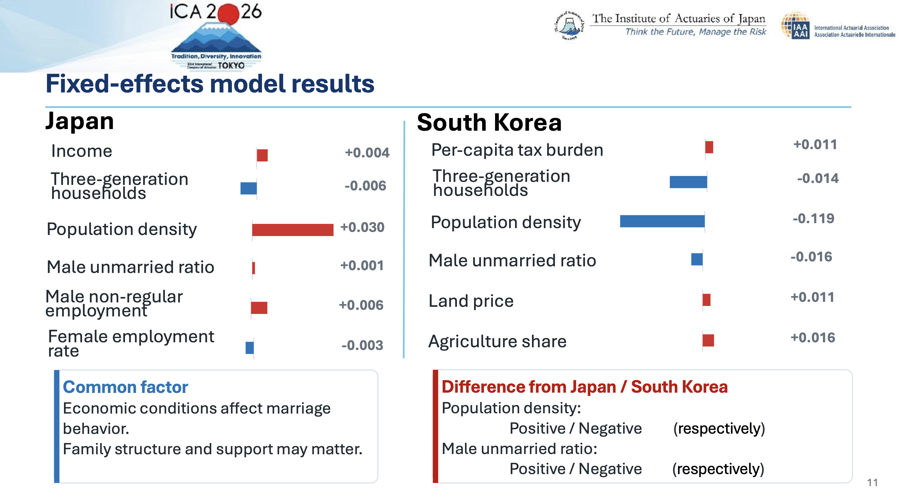
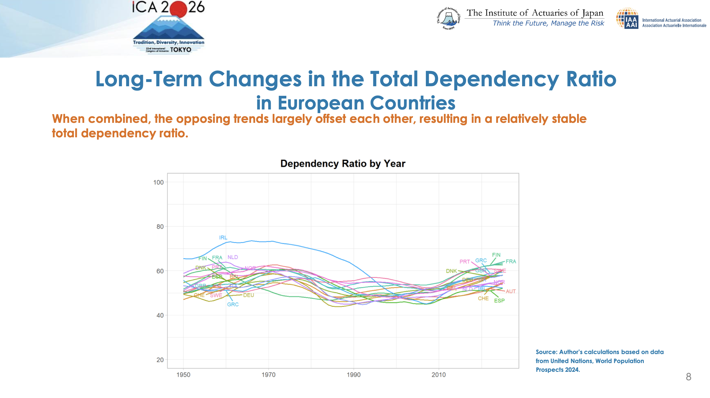
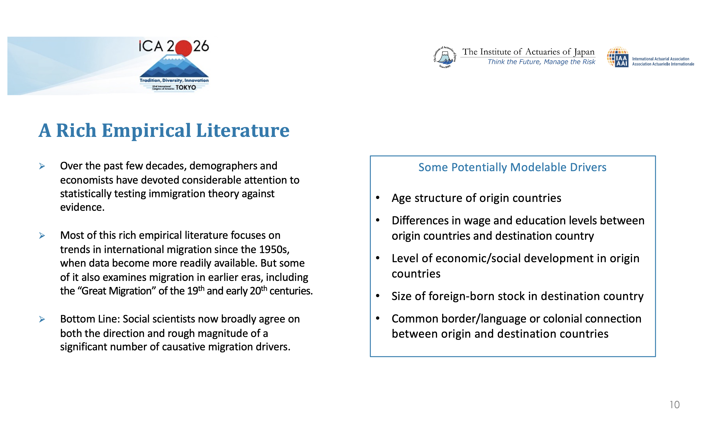
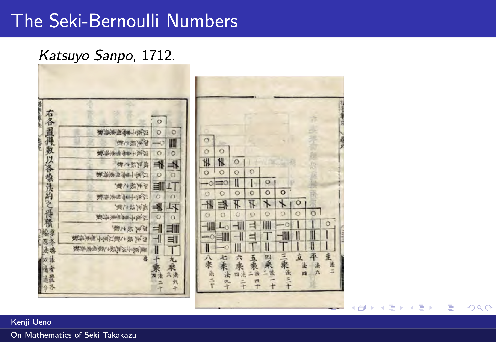

Tokiossa pidettiin tämän vuoden International Congress of Actuaries. Sain kunnian olla paikalla. Tässä hieman havaintoja esityksistä ja keskusteluista.
KOnferenssissa oli lukuisia AI-aiheisia tutkimuksia, mutta kävin melko vähän niitä katsomassa. 

 
_Kuvio 1. ICA:n logo._

## 1 Tekoäly ja ajattelun ulkoistaminen

Yksi ensimmäisistä puheista ICA2026-kokouksessa oli Dorothy L. Andrewsin puhe AI:n vaikutuksista. Tiedetään, että AI kykenee ylittämään ennustevoimalta perinteisen regressioanalyysin.
Puheessa Andrews varoitti tekoälyn aiheuttamista vaaroista, erityisesti liittyen ajattelun ulkoistamiseen tekoälylle. MRI-kuvissa aivojen toiminnassa näkyy suuri ero ChatGPT:tä käyttävien ja niiden jotka tekivät tehtävän itse välillä.
Kalvoja keynotesta ei valitettavasti ole.

## 2 Kolumbian kuolleisuus

Andrés Torres ja Andrés Sales esittelivät Kolumbian kuolleisuuden tilastoja tutkimuksessa [Pandemics and Peace: Unpacking Mortality Trends in Colombia (1982–2023) through an Actuarial Lens](https://www.micenavi.jp/ica2026/app/webroot/i/pdf/presentation_628.pdf). Niistä näkyy suuri ero kuolleisuudessa sukupuolten välillä ja kuolleisuuksien erilainen kehitys. Vuosina 1982-1992 miesten kuolleisuus ei alentunutkaan tavanomaiseen tahtiin, vaan 10-vuotiaan elinaika lähti laskuun. Selitys on murhien määrän kasvu sisällissodan seurauksena. Naisilla vastaavaa ei näy, vaikka myös naisilla on välivallasta johtuvaa kuolleisuutta. Selitys on erilainen: naisilla kyse on perheväkivallasta, miehillä murhista. Kuvio 2.

 
_Kuvio 2. Kolumbian elinajanodote 10-vuotialle._

Tutkimuksessa tarkastellaan myös Covid-19 -kuolleisuutta. Se oli äkillinen shokki, joka katosi muutamassa vuodessa. Sitä vastoin miesten kuolleisuuteen väkivallan pitkäkestoinen shokki ei ole kadonnut vieläkään.
Väkivaltainen kuolema aiheutti korkeimmillaa 33 prosenttia 10-84 -vuotiaiden miesten kuolemista. 

 
_Kuvio 3. Kolumbian kuolleisuus sukupuolittain._

## 3 Boosted Trees as generalized linear models

Hiroki Sabata esitteli tutkimuksensa [GLM Expression of GBM predictive models Unveiling the black box of a machine learning methodology](https://www.micenavi.jp/ica2026/app/webroot/i/pdf/presentation_125.pdf).
Siinä hän näytti, että Gradient boosted trees -metodologia voidaan ymmärtää yleistettynä lineaarimallina, kun ennustetaan datan kuullumista kategorioihin.

Gradient boosted decision trees -menetelmät (esimerkiksi LGBM) jakavat data puurakenteiden avulla kategorioihin. 
Menetelmät ovat olleet tehokkaita Kaggle-kilpailuissa selittämään keskikokoisia datajoukkoja. Ne ovat päihittäneet neuroverkkomenetelmät selvästi.

GBM:iä voi tarkastella ekvivalentteina yleistettyinä lineaarisina malleina, vaikka niissä voi olla tuhansia puita. Tämä on tutkimuksen keskeinen sanoma, joka sen mukaan helpottaa satunnaisten metsien ymmärtämistä ja käyttöä.

## 4 Hyvinvointiohjelmat osana sairaanhoitoa

Yuri Miyamori esitteli tuloksia sitä, miten hyvinvointiohjaus (specific health guidance, SHG) vaikuttaa sairausmenoihin. Tulokset olivat raflaavia: jopa 20 prosentin alenema elämäntapoihin liittyvissä menossa niillä, jotka osallistuivat hyvinvointiohjaukseen. Tutkimuksessa tarkasteltiin Wellness-Star -tietokantaa, jossa on terveystarkastustiedot ja korvaushakemukset usealta sadalta tuhannelta vakuutetulta. Tutkija käytti strafiointia vähentääkseen valikoitumista ja vertailu tuloksia kontrolliryhmiin. Tuloksia seurattiin viiden vuoden ajan. 

Tutkimuksen ongelma oli, että siinä ilmeisesti oli vahvaa valikoitumista, joka voi selittää koko tuloksen. Kalvoja ei valitettavasti ole saatavilla.

## 5 COVID-19 esiintyvyys eri ryhmissä

[Takao Yabuki](https://www.micenavi.jp/ica2026/app/webroot/i/pdf/presentation_161.pdf) tarkasteli COVID-19 esiintyvyyttä eri tavoin jaetuissa ryhmissä. Ryhmijakoja olivat mm. tupakoivat/ei-tupakoivat, liian vähän nukkuvat/ei, napostelevat/ei. Aineistona oli Wellness-Star data Japanin terveydenhoitojärjestelmästä, ja erityisesti sen terveyskyselydata, vakuutus ja korvausvaatimukset.

Kuvio 4. Covid-19:sta esiintyvyys naiset vs miehet ikäryhmittäin.

Tulosten mukaan naiset sairastivat hieman miehiä enemmän koronaa, mutta tämä voi olla valikoitumisilmiö, koska naiset käyttävät enemmän terveyspalveluita. Ikärakenne vaikuttaa: nuorilla koronaa oli vanhempia enemmän.

Moni liittyvä tekijä on intuitiivinen. Kaikissa ikäryhmissä liian vähäinen nukkuminen liittyi koronan sairastamiseen.

Osa liittyvistä tekijä taas on erikoinen. Kaikissa ikäryhmissä tupakointi liittyi pienempään koronan sairastamiseen. Ikä ei selitä tätä eroa. Samoin alkoholin käyttö: mitä enemmän alkoholia käytti, sen alempi sairastaminen. On epäselvää, mikä selittää eron, mutta valikoituminen lienee takana tavalla tai toisella. Hieman yllättäen nämä samat tekijät käyttäytyvät influenssa kanssa juuri päinvastoin kuin koronan: tupakoijilla ja alkoholia käyttävillä influenssa on tavanomaisempaa.

## 6 Sijoitustuottojen mallinnusta

Takahiro Kobayashi esitteli tutkimustaan ["Structure-Guided Reinforcement Learning for Partially Observed Multi-Period Portfolio Optimization with Transaction Costs"](https://www.micenavi.jp/ica2026/app/webroot/i/pdf/presentation_336.pdf), jossa optimoidaan salkkua useammalla tarkasteluperiodilla. 
Siinä on yhdistetty Reinforced Learning -metodologiaa, teoriaa ja kokeilua. Esittelijä kertoi, ettei kaikkea saada teorialla kuntoon, mutta malli toimii käytännössä. Tutkimus on kiinnostava, mutta ei aivan valmis.

## 7 Aasian syntyvyyttä

Toki Yutaka Taniguchi, Toki Oyama ja Takuro Sorihashi esittelivät Etelä-Korean ja Japanin syntyvyyden laskun syitä vertaamalla vuosien 2015 ja 2025 tietoja tutkimuksessaan ["A Study of Fertility Decline in Japan and South Korea Focusing on the Factors Behind the Rise in Female Unmarried Rates"](https://www.micenavi.jp/ica2026/app/webroot/i/pdf/presentation_133.pdf).

Kuvio 5. Fixed effects-mallin tuloksia.

Tutkimus pyrkii antamaan vastauksen siihen, mitä tekijät vaikuttivat syntyvyyden laskuun. Tulosten mukaan syyt ovat Japanissa hieman erilaisia kuin Etelä-Koreassa. Tutkimuksen mukaan lapsia syntyy näissä maissa lähes yksinomaan avioliitossa, joten tutkimus keskittyy tarkastelemaan niiden naisten osuutta, jotka eivät mene naimisiin. Tulosten mukaan molemmissa maissa mahdollisuuksia tavata kumppani on, mutta kriteerit parisuhteelle eivät täyty. Esimerkiksi Japanissa se, että nainen ansaitsee miestä enemmän tai on miestä koulutetumpi estää parinmuodostusta ja sitä kautta alentaa syntyvyyttä. Molemmissa maissa vaikuttaa myös se, ettei ole pakottavaa syytä tehdä parinvalintaa. 

Mallinnuksen mukaan Etelä-Koreassa väestön asumistiheys alentaa avioituvuutta ja syntyvyyttä, mutta Japanissa kasvattaa. Molemmissa maissa kolmen sukupolven yhteisasuminen vähentää avioituvuutta.

## 8 Huoltosuhde ja syntyvyys

Junko Koei pohti sitä, mikä selittää huoltosuhteen pysymisen melko vakaana tutkimuksessaan ["Population Age Structure and Contemporary Low Fertility: Evidence from Long-Term Changes in Dependency Ratios"](https://www.micenavi.jp/ica2026/app/webroot/i/pdf/presentation_204.pdf). Tutkimuksessa tarkastellaan 16 Euroopan maata ja Itä-Assian maita.

Kuvio 6. Huoltosuhde eri maissa.

Väestöllinen huoltosuhde tarkoittaa työikäisten (15-64 -vuotiaiden) määrän suhdetta muunikäiseen väestöön. Muunikäisessä on mukana sekä alle 15-vuotiaat että 65 vuotta täyttäneet. Tutkimuksen mukaan 65 vuotta täyttäneiden määrän kasvu liittyy alle 15-vuotiaiden määrä laskuun. Lapsihuoltosuhteen ja vanhushuoltosuhteen välillä on negatiivinen korrelaatio kaikissa aineistossa 
1950-luvulta asti, mutta erityisesti 2000-luvulla.
Hieman yllättäen tutkimuksessa päädyttiin siihen, että jos maan lapsihuoltosuhde on ollut korkea 1950, on sen lapsihuoltosuhde erityisen matala vuonna 2022. 

## 9 Maahanmuuton ajurit

Liaw Huang ja Richard Jackson esittivät tutkimustaan [Immigration Projection Practice and How to Improve It](https://www.micenavi.jp/ica2026/app/webroot/i/pdf/presentation_441.pdf) argumentoivat, että maahanmuuton ajureita on mahdollista mallintaa varsinkin pidemmällä aikavälillä. Koska maahanmuutto on eräänlainen substituutti matalalle syntyvyydelle kansantalouden näkökulmasta, on tarpeen ymmärtää, mitka tekijät ajavat nettomaahanmuuttoa.

Suomessa Tilastokeskus käyttää väestöennusteessaan uusinta havaintoa nettomaahanmuutosta. Tästä syystä väestöennusteen tulokset heiluvat nopeasti. Tämä ei tee tulevaisuuden suunnittelua helpommaksi, ja Tilastokeskuksen valinta on herättänyt keskustelua.

Kuvio 7. Mahdollisia ajureita maahanmuutolle.

On olemassa useita selityksiä maahanmuuton ajureista. Täydellisesti asioita ei ymmärretä, mutta pelkät taloudelliset kannusteet eivät riitä selittämään maahanmuuttoa länsimaihin, vaan lisäksi tarvitaan mm. verkostoefektien ymmärtämistä puhumattakaan paikallisista kriiseistä (sodat, luonnonkatastrofit).

## 10 Japanilainen matematiikka

Kenji Ueno ja Tsukane Ogawa esittelivät [japanilaisen matematiikan kehitystä](https://www.micenavi.jp/files/api/ICA2026/SP_WA/WA-1_slides1106.pdf).
Japanilainen matematiikka kehittyi kiinalaisen matematiikan pohjalta, jota se sitten jatkojalosti. Menetelmät kehitettiin Edo-kaudella länsimaista riippumatta. Keskeiset kehityskohteet olivat lukuteoria ja yhtälöiden ratkaisu. Vaikka matemaatikot löysivät tavan ratkaista yhtälöryhmiä yli 80 vuotta ennen länsimaisia matemaatikkoja, ei heillä ollut käsitystä todistamisesta. 

Kuvio 8. Japanilaista matematiikkaa

## 11 Yhteenveto

Kokouksessa oli monta kiinnostavaa teemaa esillä. Ei ehkä kuitenkaan mitään vallankumouksellista, vaikka AI:n rooli tuli vahvemmin kuin missään kokouksessa aiemmin samaan aikaan kun perinteisten aktuaarimenetelmien paino oli pienentynyt. Maailma on selvästi muuttumassa.

